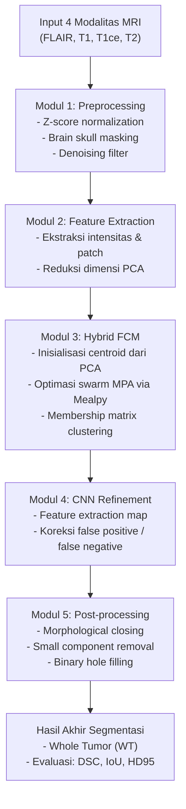

# Arsitektur & Alur Kerja Pipeline

Dokumen ini menjelaskan alur kerja teknis modul segmentasi tumor otak multimodal MRI.

## Alur Pipeline End-to-End

## Rincian Modul

### 1. Preprocessing (`src/preprocessing.py`)
* Membaca file format NIfTI (`.nii` / `.nii.gz`) menggunakan SimpleITK.
* Melakukan penyesuaian kontras dan normalisasi z-score pada jaringan otak aktif.
* Menghilangkan tulang tengkorak (*skull stripping*) berbasis intensitas ambang batas dan morfologi biner.

### 2. Feature Extraction (`src/feature_extraction.py`)
* Menggabungkan informasi spasial multi-kanal dari FLAIR, T1, T1ce, dan T2.
* Mengekstrak patch lokal dan fitur tekstur matriks kookurensi (GLCM).
* Menerapkan Principal Component Analysis (PCA) untuk mereduksi dimensi tanpa kehilangan variansi informasi esensial citra.

### 3. Hybrid Fuzzy C-Means (`src/hybrid_fcm.py`)
* Menghindari kelemahan FCM standar yang sensitif terhadap inisialisasi awal acak dengan menggunakan centroid terarah hasil PCA.
* Memanfaatkan Marine Predators Algorithm (MPA) untuk mengoptimasi fungsi objektif jarak fuzzy.

### 4. CNN Refinement (`src/cnn_module.py`)
* Menggunakan arsitektur konvolusi berbasis Keras/TensorFlow.
* Menghasilkan probabilitas batas kontur tumor untuk menyempurnakan hasil pengelompokan FCM.

### 5. Postprocessing & Evaluasi (`src/postprocessing.py` & `src/evaluation.py`)
* Operasi morfologi matematika (penutupan celah / `binary_closing`, pengisian rongga / `binary_fill_holes`).
* Pembersihan pulau-pulau kecil derau di luar jaringan tumor utama.
* Perhitungan metrik kuantitatif:
  * **Dice Similarity Coefficient (DSC)**
  * **Intersection over Union (IoU)**
  * **95th percentile Hausdorff Distance (HD95)**
  * **Sensitivitas dan Spesifisitas**

